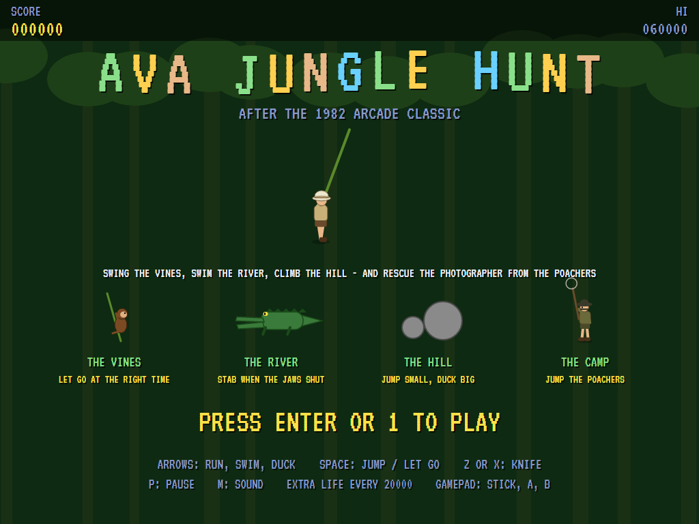
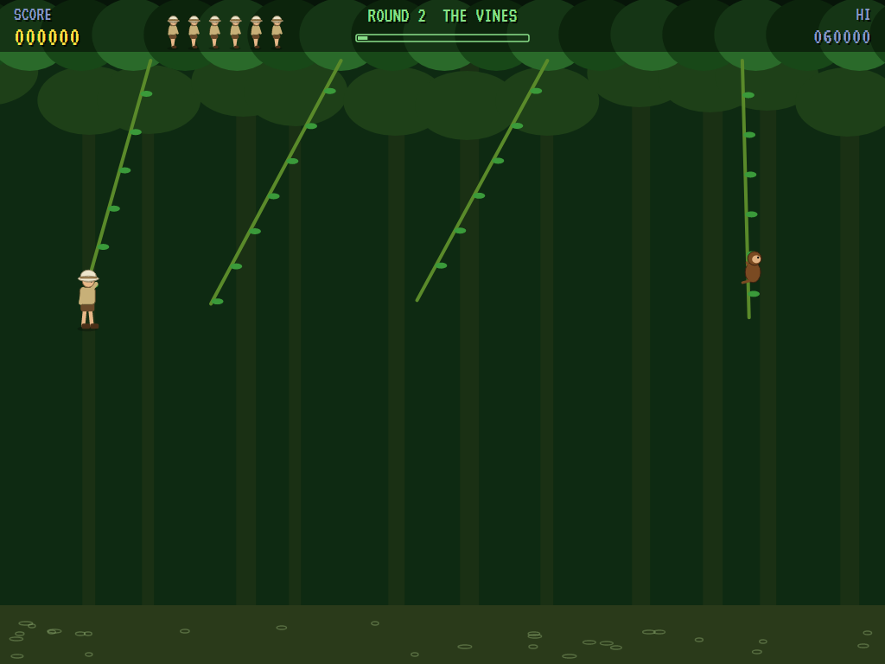
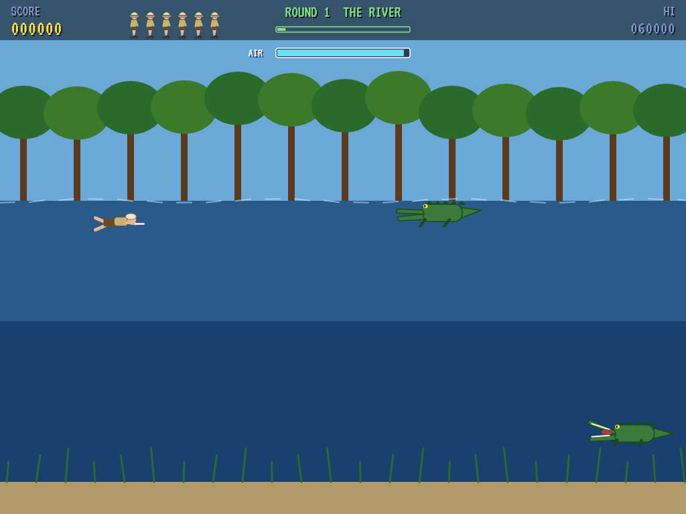
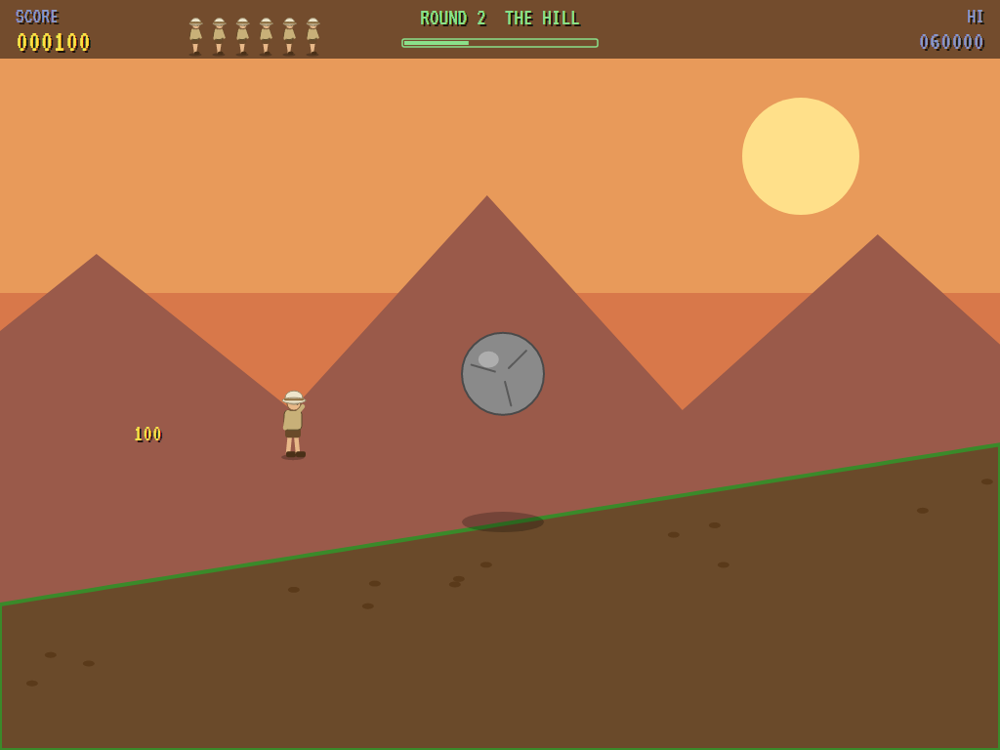
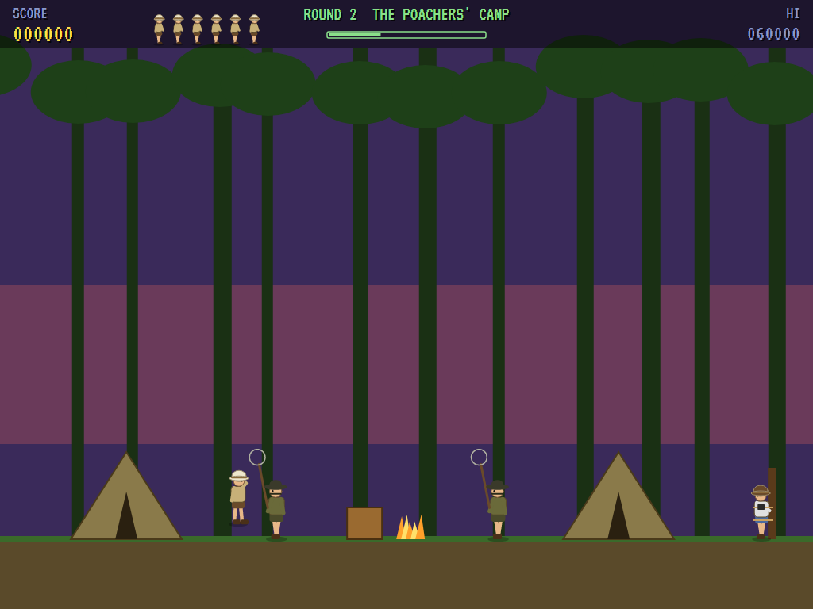
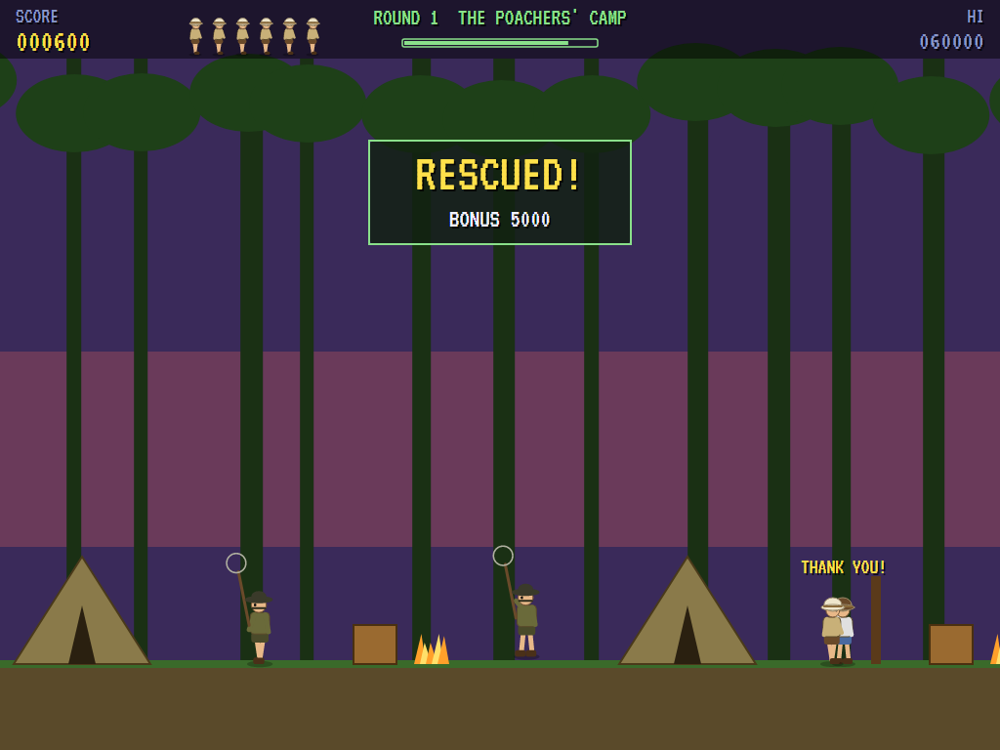
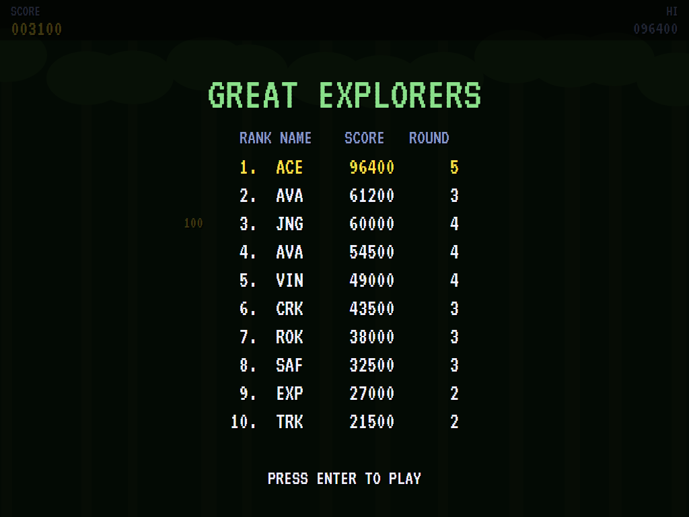

# AVA Jungle Hunt

[](https://github.com/Harlock123/AVAJungleHunt/actions/workflows/build.yml)

A four-scene adventure in the style of Taito's 1982 arcade game **Jungle Hunt**, built with .NET 10 and
Avalonia UI. An explorer in a pith helmet sets out to rescue a wildlife photographer from a camp of poachers,
and each round takes him through four scenes:
1. **The vines:** swinging from vine to vine over a swamp.
2. **The river:** swimming among crocodiles.
3. **The hill:** running up a slope while boulders bound down it.
4. **The camp:** jumping past the hopping poachers to the photographer, tied to a post.

## Features

- **The vines** swing like real pendulums, each at its own pace.
  - Let go at the right moment and the swing carries you to the next one; at the wrong one, you're in the
    swamp.
  - From the second round, monkeys climb up and down some of the vines. Catch one where the monkey is and
    you're knocked off.
  - Every gap in every round is checked to be crossable when the vines are laid out.
- **The river:** swim along and dive. Your air runs down underwater and comes back at the surface.
  - Crocodiles swim at every depth, some right at the surface, their jaws opening and shutting.
  - Touching one is the end. Your knife only works on a crocodile with its jaws shut, and an open mouth
    reaches further.
- **The hill:** run up the slope, jump, or duck.
  - Small boulders bounce low: jump them.
  - Big ones bound high: duck under them as they go over.
- **The camp:** poachers with net poles hop up and down, and to and fro, in your way. Jump each one while
  it's down, then reach the photographer to rescue them.
- **Each round** is harder: more vines and more monkeys, more crocodiles with their jaws open longer, more
  and quicker boulders, more poachers hopping higher. There's an extra life every 20000.
- **The attract mode** shows each scene in turn. The computer player plays them all by looking ahead with
  the game's own movement:
  - it lets go of a vine when the flight would catch the next (clear of its monkey)
  - it stabs crocodiles when their jaws are shut and keeps clear of open mouths
  - on foot, it tries running, jumping, ducking and waiting a second and a half ahead, and takes the first
    that keeps it whole
- **The sounds** are all synthesised: the swish of a vine, splashes, the knife, a gulp of air, the boulders'
  rumble, and a marimba tune over hand drums.

## Screenshots

| The title | The vines | The river |
|:---------:|:---------:|:---------:|
|  |  |  |
| The four scenes. | A monkey on the vine ahead. | Crocodiles, jaws open and shut. |

| The hill | The camp | The rescue |
|:--------:|:--------:|:----------:|
|  |  |  |
| A big one bounding down. | Over the poachers. | Rescued. |

The high scores: 

The screenshots are made by the tests, which play the game in a real (headless) window; see
[Tests](#tests).

## Download and run

Ready-to-run builds for Windows, macOS and Linux, on both Intel/AMD and ARM, are on the
[Releases page](https://github.com/Harlock123/AVAJungleHunt/releases/tag/latest). **Latest build** is
rebuilt on every push to `main`. Each download is one self-contained executable: no .NET install is
needed.

| Platform | Archive |
|---|---|
| Windows | `AVAJungleHunt-win-x64.zip`, `AVAJungleHunt-win-x86.zip`, `AVAJungleHunt-win-arm64.zip` |
| macOS | `AVAJungleHunt-osx-arm64.tar.gz` (Apple silicon), `AVAJungleHunt-osx-x64.tar.gz` (Intel) |
| Linux | `AVAJungleHunt-linux-x64.tar.gz`, `AVAJungleHunt-linux-arm64.tar.gz`, `AVAJungleHunt-linux-arm.tar.gz` |

```bash
tar -xzf AVAJungleHunt-linux-x64.tar.gz     # or linux-arm64, linux-arm, osx-arm64, osx-x64
./AVAJungleHunt
```

On Windows, unzip and run `AVAJungleHunt.exe`. On macOS, if Gatekeeper refuses to open it, run
`xattr -d com.apple.quarantine AVAJungleHunt` once. Run with `--no-audio` for silence.

**Sound** comes through OpenAL Soft, built in for every platform. In a virtual machine the game
detects it and uses a larger audio buffer, so the sound doesn't break up.

**Gamepads** use SDL2, which is bundled for Windows, macOS and Intel/AMD Linux. ARM Linux builds need it
installed; without it the keyboard still works:

```bash
sudo apt install libsdl2-dev            # Debian / Ubuntu / Raspberry Pi OS
sudo pacman -S --needed sdl2-compat     # Arch / Omarchy
```

## Controls

| Action | Keyboard | Gamepad |
|---|---|---|
| Start | Enter or 1 | Start |
| Let go of a vine; jump | Space (or Up, on foot) | A |
| Run | Left / Right (or A / D) | Left stick / D-pad |
| Swim up / down | Up / Down (or W / S) | Left stick / D-pad |
| Duck | Down (or S) | Down |
| Knife | Z, X or Ctrl (Space too, in the river) | B, X or right trigger |
| Pause | P or Esc | Start |
| Quit (while paused) | Esc | Back |
| Sound on/off | M | |
| Screenshot | Ctrl+S (to your Pictures folder) | |

On the high-score table, type your initials, or use up/down and Space, then Enter.

## Tests

```bash
dotnet test AVAJungleHunt.slnx
```

The engine has no UI and runs in fixed 60 Hz steps, so it plays the same at any frame rate, and a seed
always plays the same game. The tests check:

- **The vines:**
  - every vine reachable from the one before, in every round
  - the pendulum swing, with him swinging on it
  - letting go at the right moment and the wrong one
  - the monkey
  - the far bank ending the scene
- **The river:**
  - air running out and coming back
  - the knife against shut and open jaws
  - touching a crocodile, and an open mouth's reach
  - crocodiles coming on as the screen reaches them, and the far end
- **The hill:**
  - running up the slope, jumping and ducking
  - small boulders jumped and big ones ducked
  - boulders coming and scoring
- **The camp:** poachers hopping, caught and jumped, and the rescue starting the next round
- **The machine:**
  - each round harder
  - extra lives, the last life, and initials
  - the demonstrations of each scene
  - starting a game
  - the computer player getting through a whole round
  - the same game from the same seed, and pausing

The screenshot tests draw the real screen in a headless window. To refresh the README's pictures:

```bash
JUNGLEHUNT_SHOTS=$PWD/Images dotnet test tests/AVAJungleHunt.Tests --filter ScreenshotTests
```

To see how the computer player gets on, scene by scene (for tuning; `1` for the pilot, `lazy` for one that just
runs right jumping and stabbing, `scenes` to drop the lazy one into each scene in turn):

```bash
JUNGLEHUNT_PROBE=1 dotnet test tests/AVAJungleHunt.Tests --filter PilotProbe --logger "console;verbosity=detailed"
```

## Building

```bash
dotnet build AVAJungleHunt.slnx
dotnet run --project src/AVAJungleHunt
```

Needs the .NET 10 SDK. The sounds are made by `tools/make_sounds.py` (standard-library Python):
`python3 tools/make_sounds.py` rewrites `src/AVAJungleHunt/Sounds`.

## Project structure

```
AVAJungleHunt/
├── AVAJungleHunt.slnx
├── src/AVAJungleHunt/
│   ├── Engine/
│   │   ├── GameEngine.cs        # States, the title and demo cycle, the music
│   │   ├── GameEngine.Play.cs   # The four scenes: vines, river, hill and camp; rounds and scoring
│   │   ├── ExplorerPilot.cs     # The computer player, for the demonstration (and the tests)
│   │   ├── Entities.cs          # The explorer, vines, crocodiles, boulders and poachers
│   │   ├── HighScoreTable.cs, InitialsEntry.cs
│   │   ├── InputHandler.cs, ControllerManager.cs  # Keys and an SDL2 gamepad
│   │   └── SoundManager.cs      # Effects and the tunes through OpenAL
│   ├── Audio/                   # The OpenAL engine (from the author's AVABand)
│   ├── Views/                   # The drawing: the four scenes, the people and animals, and the screens
│   └── Sounds/                  # The synthesised effects and tunes
├── tests/AVAJungleHunt.Tests/   # Gameplay, screenshot and probe tests
├── tools/make_sounds.py
└── Images/                      # Screenshots
```

## About and licence

AVA Jungle Hunt © 2026 Lonnie Watson, under the [MIT License](LICENSE).

*Jungle Hunt* © 1982 Taito; the name belongs to its current owner. AVA Jungle Hunt is an independent,
unofficial game in its style. Its explorer, photographer, poachers and animals, its scenes, graphics, sounds,
tunes and code are its own; nothing is taken from the arcade machine's program, graphics, sound or music. It
is not affiliated with or endorsed by any rights holder.
